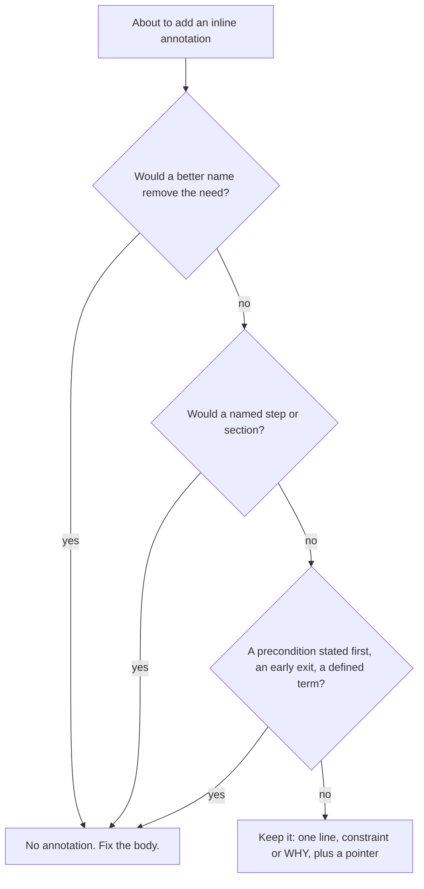

# Comments and Annotations — worked examples and reference

The on-demand companion to the comments-and-annotations rule. The rule says
what to do; this file shows it. It is **not** loaded into every session — open
it when you are about to add, shorten or review an annotation and want the
worked shape. Nothing here adds to the rule or relaxes it.

The examples name decision records, knowledge-base entries, tickets and
evaluation records by the same project pointers the rule file carries
(`<DECISION-RECORD-ID>`, `<KB-ENTRY-ID>`, `<TICKET-ID>`, `<EVAL-RECORD-ID>`
until a project fills them in). Fill them here when you fill them there.

## Worked examples

### A. Source code: narration dissolves into named steps

Before: every comment restates the line beneath it, and one wall of lines needs
a comment precisely because it is a wall.

```java
public ExportResult execute(final UUID reportId, final String format) {
    // Find report
    final Report report = reportRepository.findById(reportId)
        .orElseThrow(() -> new ReportNotFoundException(reportId));
    // Verify status allows export
    if (!report.getStatus().canExport()) {
        throw new IllegalStateException("Cannot export report in status: " + report.getStatus());
    }
    // Step 1: Render the report
    final RenderedReport rendered = renderer.render(report, format);
    // Step 2: Store the rendered file (using content type from renderer)
    final String extension = rendered.extension() != null ? rendered.extension() : DEFAULT_EXTENSION;
    final String contentType = rendered.contentType() != null ? rendered.contentType() : DEFAULT_CONTENT_TYPE;
    final String storagePath = storage.store(reportId + "-export" + extension, contentType, rendered.bytes());
    // Step 3: Update domain model
    report.markExported(storagePath);
    // Step 4: Save
    return new ExportResult(reportRepository.save(report).getUuid(), storagePath);
}
```

After: the steps did not disappear; they became addressable.

```java
public ExportResult execute(final UUID reportId, final String format) {
    final Report report = loadExportableReport(reportId);
    final RenderedReport rendered = renderer.render(report, format);
    final String storagePath = storeRenderedFile(reportId, rendered);

    report.markExported(storagePath);
    return new ExportResult(reportRepository.save(report).getUuid(), storagePath);
}
```

`// Step 4: Save` above a save call is the shape to recognise: the comment
count grew with the step count, and not one line told the reader anything the
code did not already say.

The comment that survives keeps its place, compressed to a pointer:

```java
// WRONG: correct content, four lines of it, in the middle of the body
// This query has to be raw SQL. The reason is that our entities carry a class-level
// soft-delete filter, which means the ORM query language silently skips soft-deleted
// rows. Since this result feeds a unique constraint, skipping them produces
// duplicate key violations at insert time.

// RIGHT: same constraint, one line, reasoning lives in its durable home
// Must be a native query: the ORM soft-delete filter skips rows, see <KB-ENTRY-ID>
```

### B. A prompt file: the same shape outside code

Before:

```text
# ---- SYSTEM PROMPT ----
# This section tells the model who it is
You are a support assistant for <product>.
# This section lists the rules the model must follow
Rules: answer in the customer's language; never promise refunds.
# We keep the JSON example below because in testing the model kept answering in prose
# when the example was removed. We tried describing the format in words twice and it
# did not help, so please leave the example in even though it looks redundant.
Respond as JSON: {"answer": "...", "escalate": true|false}
```

After:

```text
ROLE
You are a support assistant for <product>.

RULES
- Answer in the customer's language.
- Never promise refunds.

OUTPUT FORMAT
# Keep the example: without it the model drifts to prose, see <EVAL-RECORD-ID>
Respond as JSON: {"answer": "...", "escalate": true|false}
```

Headings replaced the narration. The one annotation that survives states a
constraint the text cannot show and points to the evidence. `#` is this prompt
format's comment syntax and the loader strips those lines; in a format with no
comment syntax, the pointer goes into the description block that rule 1 keeps,
not into the body the model reads.

### The same moves in other domains

| Domain | Rename | Extract | Restructure | Narration to dissolve |
|---|---|---|---|---|
| Documents | a heading that says what the section is | named sub-sections | state the assumption or precondition first | "In this section we will..." |
| Spreadsheets | header row, named ranges | a helper column with a header | input / calculation / output tabs | cell note "sums the column above" |
| Config and infrastructure | key and variable names that carry units and intent | one block per concern | fail fast on a missing value | `# set the port` above `port:` |
| Runbooks and processes | step titles that name the outcome | a named sub-procedure | "Stop if..." checks before the steps | "Step 4: run the command" |
| Slides and design | the slide title states the claim | one idea per slide, detail to an appendix | agenda as the structure | speaker notes restating the slide |
| Prompts, skills and agent instructions | a heading per concern (role, rules, output format); a description block that states the trigger | one instruction per section; reference material into a file loaded on demand | stop conditions and blocking questions before the steps | `# this section tells the model who it is` |
| Agent-workspace files: constitutions, rule files, knowledge-base entries, decision records | a symptom-style title; a rule file named for its domain | one file per domain or entry; a constitution row that points to the rule file | the imperative first, then the WRONG/CORRECT pair, then the gotchas; the required fields in their fixed order | a `> Note:` restating the heading; a preamble announcing what the file is about to say |
| Scripts, hooks and CI workflows | a function or step name that says what the step achieves; variables that carry units | one function per concern; a named job or step | fail fast on a missing input or tool, before any side effect | `# loop over the files` above a loop |
| Tests | a test name that states the behaviour under test | a named fixture or builder for the setup | the precondition as a guard or the first assertion | `// call the method`, `// check the result` (the phase markers themselves are protected, see below) |

## The litmus ladder as a flowchart



## Anti-patterns

```java
// WRONG: step narration; the count grows with the unit and says nothing new
// Step 5: Save
repository.save(order);

// WRONG: restates the line beneath it
// Loop through all orders
for (final Order order : orders) { ... }

// WRONG: section-divider banner; if a unit needs sections, it needs named steps
// ============ VALIDATION ============

// WRONG: multi-paragraph rationale in the body (belongs in a decision record)
// We chose the split-table approach here because a single table with a nullable
// owner_id would have meant ... [continues for 9 lines]

// WRONG: kept-but-disabled content; version history is the archive
// final var legacy = oldService.compute(x);
```

The non-code equivalents: "In this paragraph we explain...", a "Notes:" block
at the end of a document that repeats the body, struck-through text kept "for
reference", hidden rows, columns or slides kept "just in case", `[TODO fill in]`
left in a published document, author-to-author chatter in cell notes or speaker
notes.

In **audience-visible artifacts** (web templates, stylesheets and translation
bundles, published documents, exported spreadsheets and slide decks whose notes
travel with the file, email templates, shared prompts, changelogs, anything
that reaches a user's browser or a release artifact) three more shapes are
forbidden outright, because the audience can read them:

- **Decision-history narrative.** "We considered X but chose Y because Z."
- **Competitor or peer-product references.** "Matches the <vendor> pattern."
  Name the *behaviour*, never the company that also uses it.
- **Ticket narratives and auditor-bait reassurances.** "Per <TICKET-ID>
  feedback", "no personal data is logged here", "this satisfies § N of
  <regulation>". Compliance is proven by controls and evidence, not by inline
  claims a reader cannot verify.

A bare ticket reference on a changelog bullet (`… (<TICKET-ID>)`) is the
versioning-and-changelog rule's convention and is not an annotation; what this
rule forbids is the story around it.

## Sanctioned survivors — the shapes

Each is one short line plus a pointer to the durable home:

| Shape | Example |
|---|---|
| Hidden constraint + reference | `// Must be a native query, see <KB-ENTRY-ID>` |
| Subtle invariant + reference | `# Deactivate prior versions BEFORE inserting the new one (<DECISION-RECORD-ID> § 5)` |
| Constraint set by a decision + reference | `// Retries must be idempotent — see <DECISION-RECORD-ID>` |
| Workaround for something external + reference | `<!-- Compensates for the sticky-header offset, see <KB-ENTRY-ID> -->` |
| Brief WHY pointer to the canonical doc | `// See <DECISION-RECORD-ID> § D-8 for the microcopy doctrine` |
| Deliberate divergence from a template or shared standard | `# Not the shared blank-check: a single space is a meaningful value here` |
| Evidence pointer on a non-obvious instruction | `# Keep the example: without it the model drifts to prose, see <EVAL-RECORD-ID>` |
| Tracked TODO | `// TODO <TICKET-ID>: <what remains>` |
